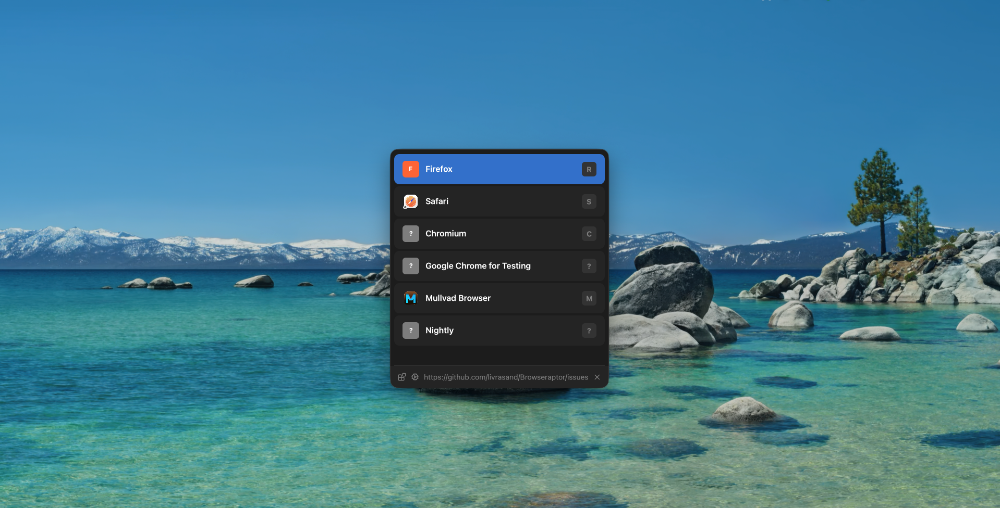

<div align="center">


# Browseraptor

**A blazingly fast, cross-platform link prompt & browser router built in Rust.**


[](https://github.com/livrasand/Browseraptor/releases)
[](https://mozilla.org/MPL/2.0/)
[](#install)

</div>

---

<div align="center">
  
</div>

---

## What is Browseraptor?

**Browseraptor** intercepts HTTP/HTTPS links system-wide and prompts you to choose which browser, profile, or app to open them with. 

Whether you keep personal and work profiles isolated, want domain-based routing rules, or need a plugin-extendable prompt, Browseraptor handles it with zero latency thanks to Rust.

> Inspired by [Browserino](https://github.com/AlexStrNik/Browserino), redesigned from scratch for speed, safety, and deep system integration.

---

## Key Features

- **Blazingly Fast:** Near-zero overhead and minimal memory footprint built in native Rust.
- **Cross-Platform:** Seamless support for macOS, Linux, and Windows.
- **Extensible Plugin System:** Write custom routing rules, URL transformations, or domain hooks.
- **Privacy & Profile Isolation:** Easily route work links to Chrome/Brave and personal links to Firefox or Safari.

---

## Install

Download pre-compiled binaries for your operating system from the latest release:

<a href="https://github.com/livrasand/Browseraptor/releases">
  
</a>

---

## Building from Source

### Prerequisites

Browseraptor requires the **Rust nightly** toolchain.

```sh
# Install Rust
curl --proto '=https' --tlsv1.2 -sSf [https://sh.rustup.rs](https://sh.rustup.rs) | sh

# Install nightly toolchain
rustup toolchain install nightly

```

### Build Instructions

Requires Xcode Command Line Tools (`xcode-select --install`).

```sh
git clone [https://github.com/livrasand/Browseraptor.git](https://github.com/livrasand/Browseraptor.git)
cd Browseraptor 
cargo build --release

# Build .app bundle
chmod +x bundle_macos.sh
./bundle_macos.sh
# Output: dist/Browseraptor.app

```

Install system dependencies:

```sh
# Debian / Ubuntu
sudo apt install libgtk-3-dev libxdo-dev libssl-dev pkg-config

# Fedora / RHEL
sudo dnf install gtk3-devel libxdo-devel openssl-devel

```

Build binary:

```sh
git clone [https://github.com/livrasand/Browseraptor.git](https://github.com/livrasand/Browseraptor.git)
cd Browseraptor
cargo build --release
# Output: target/release/browseraptor

```

Requires [Visual Studio Build Tools](https://visualstudio.microsoft.com/visual-cpp-build-tools/) with **Desktop development with C++**.

```cmd
git clone [https://github.com/livrasand/Browseraptor.git](https://github.com/livrasand/Browseraptor.git)
cd Browseraptor
cargo build --release
:: Output: target\release\browseraptor.exe

```

---

## Managing the Background Daemon

Browseraptor runs as a lightweight background process. To stop or restart it:

| OS | Graceful Stop | Force Stop |
| --- | --- | --- |
| **macOS / Linux** | `pkill -x browseraptor` | `pkill -9 -x browseraptor` |
| **Windows (CMD)** | `taskkill /IM browseraptor.exe /F` | — |
| **Windows (PowerShell)** | `Stop-Process -Name browseraptor -Force` | — |

---

## Contributing & Community

Contributions, issues, and feature requests are welcome! Check out [CONTRIBUTING.md](https://www.google.com/search?q=/CONTRIBUTING.md) to get started.

You can use GitHub Codespaces for online development:

[![][codespaces-shield]][codespaces-link]

If you find Browseraptor useful, please **give it a ⭐ on GitHub** to help others discover it!

[](https://x.com/intent/tweet?text=Check%20out%20this%20project%20on%20GitHub:%20https://github.com/livrasand/Browseraptor)
[](https://www.facebook.com/sharer/sharer.php?u=https://github.com/livrasand/Browseraptor)
[](https://www.linkedin.com/sharing/share-offsite/?url=https://github.com/livrasand/Browseraptor)
[](https://www.reddit.com/submit?title=Check%20out%20this%20project%20on%20GitHub:%20https://github.com/livrasand/Browseraptor)
[](https://t.me/share/url?url=https://github.com/livrasand/Browseraptor&text=Check%20out%20this%20project%20on%20GitHub)
[](https://bsky.app/intent/compose?text=Check%20out%Browseraptor:%20https://github.com/livrasand/Browseraptor)
[](https://mastodonshare.com/?url=https://github.com/livrasand/Browseraptor)
[](https://news.ycombinator.com/submitlink?u=https://github.com/livrasand/Browseraptor)
[](https://www.threads.net/intent/post?text=Check%20out%Browseraptor:%20https://github.com/livrasand/Browseraptor)
[](https://wa.me/?text=Check%20out%Browseraptor:%20https://github.com/livrasand/Browseraptor)

*✨ Thanks for visiting **Browseraptor**!*


[codespaces-link]: https://codespaces.new/livrasand/Browseraptor
[codespaces-shield]: https://github.com/codespaces/badge.svg
